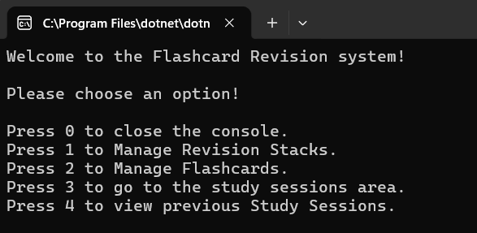
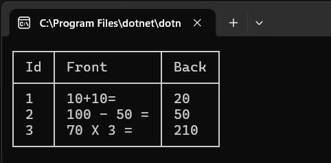
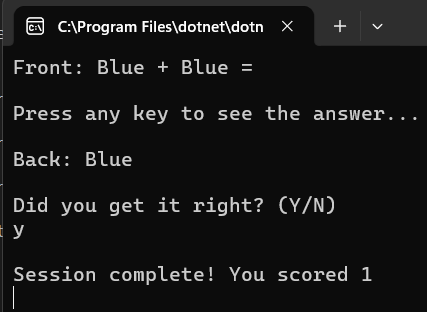

# Flashcards Project

## Overview:

This project is a flashcard application that allows users to create and manage flashcards, organize them into labelled stacks and test their knowledge through study sessions. Each flashcard contains a question on the front and an answer on the back. Completed study sessions are recorded with a date and score, allowing users to track their progress over time.

### Features:

- Stack Management: Create, view, update and delete stacks to organize flashcards by subject.
- Flashcard Management: Create, view, update and delete flashcards containing a question and answer.
- Study Sessions: Test knowledge using flashcards stored in the database.
- Session History: View previous study sessions, including their ID, score and date.

## Database setup and run
1. Install the .NET 10 SDK and SQL Server (or LocalDB).

2. Clone the repo

3. In `appsettings.json` set `DefaultConnection` to your server e.g. `Server=localhost;Database=Flashcards;Integrated Security=True;TrustServerCertificate=True;`

4. Run `dotnet run` from the project folder. The tables are created automatically on the first start of the program.

Server is the name of the local SQL Server. Database is the name of the database to connect to. Integrated Security means Windows Authentication is used instead of a username and password. TrustServerCertificate is required for local development to avoid certificate errors.

## Main menu:

## Listed Flashcards
List of flashcards within the "Mathematics" stack:

## Study Sessions Menu

The Study Sessions procedure asks the user which stack they'd like to study:

Once a id number is entered the user is shown the front of the flashcard and prompted to press any key to see the answer.

Each cards front is shown, the user presses enter to reveal the back, then marks whether they got it right. The score is shown at the end.

## Architectural Choices

### Separating input from data access:

All of the main menu methods live inside of Userinput.cs

UserInput.cs never talks to the database correctly. Its only job is gathering and validating input, then handing validated data over to DatabaseController at the end of input methods to do the actual work.

### Static StackId Field 

I decided to create a static field for stackId (private static int stackId;) as methods throughout the program would need it.
It is set once when the user enters the Manage Flashcards menu or the Study Sessions area, every flashcard and study session method reads from this field afterwards, so the user never has to re enter which stack they are working with during that session.

### Dapper

Dapper is used throughout the program to simplify our database operations, in my habit tracker I used ADO.NET to create a connection, open the connection, create the command, define the command text, execute the query all before closing the connection.

Dapper allows us to achieve the same result with much less code, For example, connection.Execute() handles the creation and execution of the command, reducing the amount of repetitive code we need to write.

This becomes particularly useful as projects grow as reducing boilerplate code makes database operations more scalable, they become easier to read, maintain and modify at a later date. Dapper also supports parameterised queries, which makes passing user input into SQL statements more straightforward and helps protect against SQL injection.

### Parameterised Queries

Like my coding tracker I adopted the use of parameterised queries instead of interpolated ones after learning the risks of using interpolated queries. Users can enter code that speaks directly to the database meaning users can enter malicious input that may be interpreted as SQL commands by the database which can result in data loss / data theft.

I started using parameteried queries to eliminate that risk as SQL parameters ensure that values supplied by users are handled as literal data instead of being executed as part of the query itself.

I am interested to see how Entity Framework simplifies database operations even further.

### Database design

The program uses three tables, Stack, Flashcard and StudySessions. Flashcard and StudySessions both have a StackId foreign key that references the Stack table, This ensures that every flashcard and study session belongs to an existing stack. Both foreign keys use ON DELETE CASCADE in the create Stack, Flashcard and StudySessions table methods meaning that when a stack is deleted, its associated flashcards and study sessions are automatically deleted as well, as the specification asks for. Stack names are unique which is what allows stacks to be chosen by name. Flashcards are unique within each stack through the `UNIQUE (StackId, Front)` constraint. This stops the same question or front from being added more than once to a particular stack while still allowing the question to exist in different stacks.

### DTOS and display IDs

I created a DTO named FlashcardsDto which contains all of the properties the Flashcards model has except for StackId. StackId is left out of the DTO because its not something we want the user to know about, when displaying information the user should only see the Id of their flashcard entry, the text of the front of the flashcard as well as the text on the back of the card. The DTO model is used in the GET methods (GetFlashcardRecords & GetFlashcards) in the database controller as well as the in the StartSession method. GetFlashcardRecords loads Flashcards models and converts them to DTO's and GetFlashcards return DTO'S for StartSession.

The Id shown to the user is not the database Id, Database Id's are permanent and leave gaps after deletions but the specification requires flashcards to be numbered from 1 with no gaps. When displaying a stack I load its cards ordered by Id and create a FlashcardDTO for each one, using its position in the same ordered list as the Id. When the user chooses a card to update or delete, GetRealFlashcardId finds the card at that position in the same ordered list and uses its real Id. The update and delete queries also filter by StackId, so only cards in the current stack can be changed.

## Refactoring

### Choosing stacks by name

After finishing I realised that one of the requirements was to have the user choose using the name of the stack rather than the Id. I originally used the stack Id, so I refactored the Manage Stacks insert, update and delete options to use the stack’s unique name instead.

### Input validation

While testing, I noticed the user was only asked once for each input, so empty values could be saved. I created a GetNonEmptyInput method that keeps asking until a non empty value is entered and trims the result. Several methods in the UserInput class now use it, so input is validated the same way everywhere.

### Checking a stack exists

Testing showed that any number was accepted as a stack Id, and starting a study session on a stack that didn’t exist crashed when the session was saved. I added a StackExists check and a GetExistingStackId helper, used by both the flashcard and study session menus, which keeps asking until the stack exists or the user enters 0 to go back.

### Duplicate stack names

Inserting a stack name that already existed caused SQL Server to throw error 2627 exception (unique constraint violation) which crashed the app. To combat this I implemented a try/catch inside the InsertStack controller method that handles only that error and shows a message, The same applies to when renaming a stack to a name that already exists.

### Menu navigation

In the Manage Stacks and Manage Flashcards menus, the "0" option now sets end = true to exit the loop instead of calling GetUserInput() again. Calling the menu from inside itself started a new menu on top of the old one each time, so the call stack kept growing. Each menu is now a loop, and submenus return to their caller.

### Empty study sessions

Starting a session on a stack with no flashcards showed a score of 0 and saved an empty session. StartSession now checks for this first and returns with a message, so empty sessions are never saved.

## Reflection

The study sessions part was the toughest for me but after completing that I felt confident to move forward. 

I did have a few configuration issues with SQL server in the beginning, as there are many different configurations for a database, each database must be configured in the way you would like, preferably clearly naming what database belongs to each project. When refactoring some code in the CreateFlashcardTable method I needed to change some constraints of the properties in the flashcards table, this meant I needed to drop the table that had been built on creating the project and create the new version. When entering the DROP TABLE Flashcard; query I accidentally queried the incorrect database. Whilst this isn't an issue on my project I could have easily caused real damage in a real dataset, this experience has helped me understand the importance of slowing down before running destructive queries. I now check the database dropdown in SSMS and start queries with a USE statement, so the target database is explicit.

I spent a lot of time refactoring code based on feedback from reviewers, this has given me an insight on how meticulous you have to be when writing code. Things I believed I had completed correctly the first time around actually needed much more improvement and testing, using the program like a real user would (incorrect types of input etc) was the best way to test the code. I am eager to move onto the testing aspect of the C# Academy's projects as I am eager to learn the correct procedure for testing a project when things appear fine on the surface.

## Known Limitations

Manage Flashcards and StudySessions select a stack by Id, while Mange Stacks uses its name.